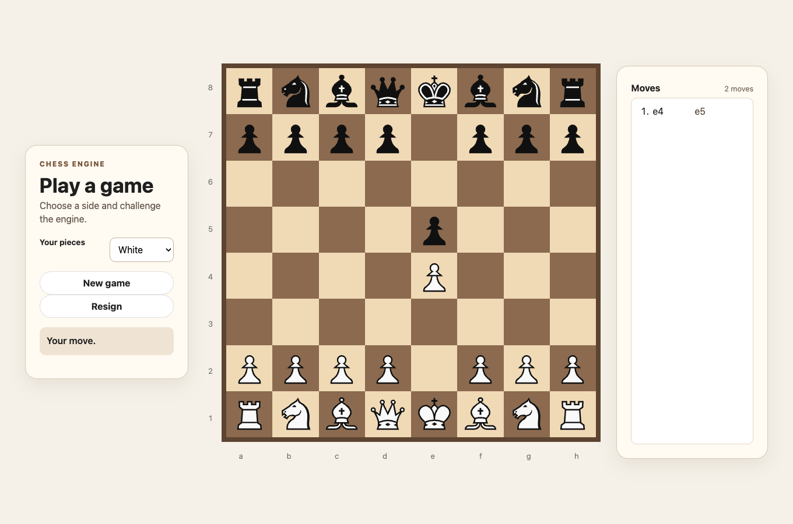
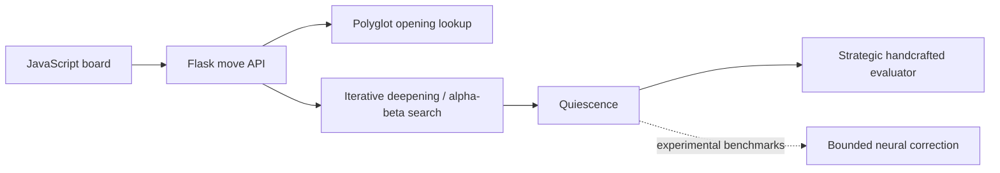

# Hybrid Chess Engine

[](https://github.com/brianyin-dev/hybrid-chess-engine/actions/workflows/ci.yml)

A browser chess application with a custom Python search engine, a handcrafted
strategic evaluator, and an experimental Stockfish-supervised neural evaluator.
The app uses the **handcrafted strategic-v26 evaluator**. Neural models have not
established a repeatable advantage in equal-time games.



## Run locally

Python 3.10 or newer is required. From the repository root:

```sh
python3 -m venv .venv
.venv/bin/python -m pip install -r requirements-engine.txt
.venv/bin/python books/install_gm2001.py
.venv/bin/python -m backend.app
```

Open **http://127.0.0.1:5000**. Choose a piece and a highlighted destination;
pawns promote to queens. Play either color, view the move list, reset or resign.
After the computer wins, a YouTube video appears; playback depends on browser
policy and network access.

The browser allows 750 ms per move, a nominal depth ceiling of eight plies, and
book lookup through at most ten full moves. Actual search depth depends on the
position and hardware. This local development server is not a public deployment.
The previous Render service is suspended; there is no active hosted demo.

## How it works



- **Search:** negamax with alpha-beta/PVS, quiescence, transposition tables,
  killer/history ordering and conservative late-move reductions.
- **Evaluation:** material, piece placement, pawn structure, development,
  mobility, king threats and strategic features.
- **Rules:** python-chess provides board representation and legal moves.
  Search preserves full history for automatic repetition and move-count draws.
- **Backend:** Flask serves the interface and API. Request-size, move-history,
  rate and concurrent-search limits return explicit errors.
- **Neural research:** PyTorch training, NumPy inference, Stockfish labels,
  ranking/retention supervision and whole-game/opening-family validation.

The timeout fix retains a completed root alternative if the very first iteration
is interrupted, rather than blindly returning the initial static fallback.
Such results still report **depth 0 and score null**, with
`search.used_partial_root: true`. They do not claim a completed minimax iteration.
Once an iteration completes, its result remains the fallback for later timeouts.

## Measured results

| Experiment | Opponent | Result | Budget |
|---|---|---|---|
| Earlier classical engine | Stockfish 19, UCI_Elo 1500 | 63W / 2D / 35L; **64% score**, 100 games | 250 ms/move |
| Same earlier classical engine | Stockfish 19, UCI_Elo 1600 | 36W / 1D / 63L; **36.5% score**, 100 games | 250 ms/move |
| v16 NN configuration | Optimized earlier heuristic | 10W / 2D / 8L; **55% score**, 20 games | 250 ms/move |
| v35 NN before timeout fix | Current strategic-v26 heuristic | 5W / 4D / 11L; **35% score**, 20 games | 250 ms/move |

Scores count draws as half a point. The larger Stockfish runs used 50 openings,
each played with both colors. Their results belong to the earlier classical
configuration, **not the NN or the current app configuration**. Stockfish's
limited-strength settings are benchmark labels, not verified human Elo ratings.
The 55% neural pilot is not a demonstrated strength improvement.

[Results and limitations](docs/RESULTS.md) ·
[Timeout-fix release notes](docs/RELEASE_NOTES.md) ·
[Experiment history](docs/PROJECT_HISTORY.md) ·
[Mobile screenshot](docs/images/local-game-mobile.png)

## Tests and experiments

The full test suite includes neural modules, so install the research dependencies
before running it (the web app itself needs only requirements-engine.txt):

```sh
.venv/bin/python -m pip install -r requirements.txt
.venv/bin/python -m unittest discover -s tests -v
```

GitHub Actions runs the suite on Python 3.10 and 3.13 with CPU-only PyTorch and
NumPy, in addition to the engine/API dependencies. No GPU is required.

The latest full local suite passed **166 tests**, including deterministic
first-iteration interruption, PVS verification, unchanged fixed-depth results,
board restoration and the two recorded neural fallback failures. Some optional artifact-dependent checks may skip when their checkpoints are
absent; the full suite requires PyTorch and NumPy at discovery time.

Recorded experiments live in `ml/RESULTS-*.md`; their scripts protect existing
output from overwrite. Keep CPU-intensive matches sequential and use the
benchmark CPU lock. Stockfish is an external teacher/opponent, not the app's
move generator. The latest 1,420→64→32→1 network has 93,057 parameters and adds a
25% bounded correction to the heuristic; it is not enabled in the web app.

## Scope and limitations

This is a local SWE/ML research project, not a Stockfish wrapper. It uses existing
libraries for chess rules, ML operations and HTTP serving. The third-party
opening book and SVG piece assets are integrated rather than authored here;
see [book provenance](books/README.md). Piece SVG assets are included in
`frontend/assets/pieces/`.

Automatic fivefold repetition and the 75-move rule are supported. Threefold and
50-move claim actions, underpromotion selection, persistent accounts, and online
multiplayer are not implemented. Python feature extraction and search remain
performance constraints; the neural evaluator can regress at equal depth too.
No claim of a trained strength improvement, human rating or active deployment
is made.
